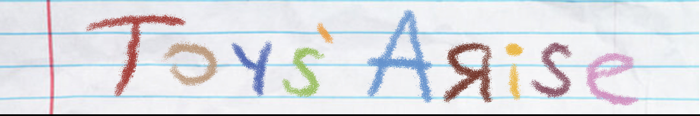

  

# Toys' Arise

Toys' Arise is a game developed as a team project using Unity and C#.

This repository serves as a portfolio showcase and contains only the scripts that I personally developed for the project. Other team members' source code and project assets are not included.

## Gameplay Video

  

  

## My Contributions

My contributions to the project focused on gameplay systems, enemy behavior, UI, and progression mechanics:

- Developed a grid based placement system for Lego like pieces, including occupied cell tracking, placement validation, and visual placement feedback.
- Implemented wave based enemy spawning with round specific spawn intervals, enemy counts, and weighted enemy selection.
- Developed enemy gameplay logic, including damage handling, death behavior, knockback, hit feedback, and coin rewards.
- Implemented the round and timer system used to control enemy waves and progression.
- Developed the shop system, including item purchasing, upgrade limits, inventory quantities, and coin management.
- Created menu and UI functionality for the main menu, credits, pause menu, tutorial, and shop interfaces.
- Used ScriptableObjects to store and manage Lego piece data such as IDs, grid sizes, and prefabs.

## Screenshots

  
  

  
  

## Technologies

\- Unity

\- C#

## Source Code

The `Scripts` directory contains the C# scripts I developed for the project.

> \*\*Note:\*\* This is not the complete Unity project. Some scripts may reference components from the original team project that are not included in this repository.

